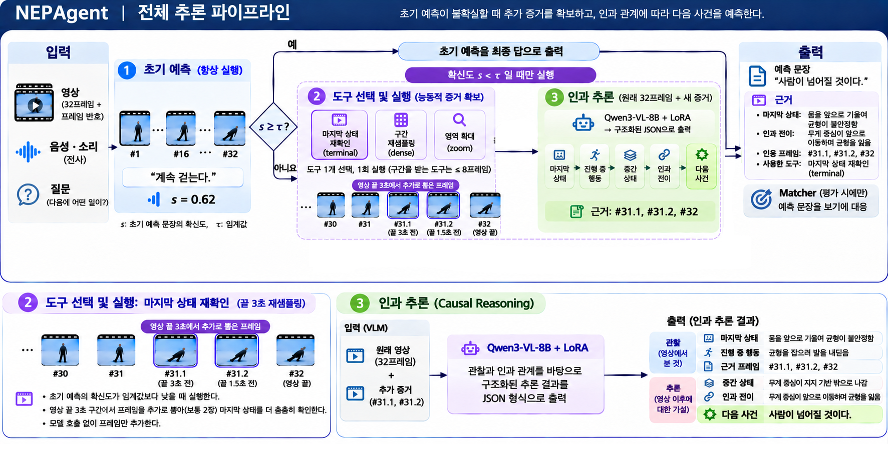

# NEPAgent: 영상 다음 사건 예측 Agent

**CJ 4DPLEX AI 개발 사전과제 · Track 1 Motion Prediction Agent**

영상의 앞부분(관찰 구간)만 보고, 바로 다음에 일어날 사건을 한 문장으로 예측하고 근거를 함께 제시하는 Agent입니다.

| 문서 | 내용 |
|---|---|
| `docs/Executive_Summary.md` | 핵심 요약 |
| `docs/Technical_Report.md` | 문제 정의, 데이터, 설계, 구현, 평가, 실패 분석, 한계 |
| `docs/System_Architecture.md` | 구조와 단계별 입출력 |
| `docs/Usage_and_Implementation.md` | 사용한 데이터·모델·오픈소스와 직접 구현 범위 |

## 1. 동작 방식



1. **초기 예측**: 프레임 번호를 표시한 32프레임과 음성 전사를 보고 다음 사건을 한 문장으로 예측합니다.
2. **확신도 게이트**: 확신도가 0.75 이상이면 초기 예측으로 끝냅니다.
3. **도구 선택·실행**: 확신도가 낮으면 모델이 도구 하나(마지막 상태 재확인, 구간 재샘플링, 영역 확대)를 골라 영상을 다시 봅니다.
4. **인과 추론**: 원래 프레임과 추가 프레임을 보고 마지막 상태 → 인과 전이 → 다음 사건을 JSON으로 작성합니다.
5. **Matcher**(보기를 준 경우에만): 예측 문장을 보기에 대응시킵니다. 보기는 이 단계에서만 쓰입니다.

모든 단계는 Qwen3-VL-8B-Instruct에 직접 학습한 LoRA를 병합한 모델 하나로 실행합니다.

## 2. 실행 환경

| 항목 | 내용 |
|---|---|
| OS / Python | Linux x86_64, Python 3.11 |
| GPU | 추론은 GPU 1장(A100 80GB 또는 RTX A6000 48GB에서 실행). 학습은 A100 80GB 1장 |
| CUDA | 12.8 (`torch==2.8.0`) |
| 디스크 | FutureOmni 테스트 영상 압축 파일이 약 46GB입니다 |

## 3. 설치

저장소 루트에서 실행합니다.

```bash
python3.11 -m venv .venv
source .venv/bin/activate
pip install --upgrade pip
pip install -r requirements.txt
```

`scripts/` 아래 스크립트는 저장소 루트에서 `PYTHONPATH=.`을 붙여 실행합니다.

## 4. 모델 준비

| 모델 | 준비 방법 |
|---|---|
| Qwen3-VL-8B-Instruct (기반 모델) | 아래 명령으로 내려받고 `VLM_PATH`로 지정 |
| NEPAgent LoRA (직접 학습) | Google Drive에서 받아 `checkpoints/`에 압축 해제 |
| Whisper small, Grounding DINO tiny | 처음 실행할 때 자동으로 내려받습니다 |

오디오 전처리에 쓰는 `panns-inference` 패키지도 처음 실행할 때 모델 파일을 자동으로 내려받습니다(예측에는 쓰지 않음).

```bash
hf download Qwen/Qwen3-VL-8B-Instruct --local-dir models/Qwen3-VL-8B-Instruct
export VLM_PATH=$PWD/models/Qwen3-VL-8B-Instruct
```

**NEPAgent 가중치**: https://drive.google.com/drive/folders/1BcRcXynS1XmF1liJ4kfvA8m83f1Vanw4

| 파일 | 압축 해제 위치 |
|---|---|
| `nep_agent_lora_merged.zip` (병합 모델, 권장) | `checkpoints/nep_agent_lora_merged/` |
| `nep_agent_lora.zip` (어댑터) | `checkpoints/nep_agent_lora/` |

실행 시 로드하는 것은 병합 모델(`checkpoints/nep_agent_lora_merged/`)입니다. 병합 모델을 받으면 바로 실행할 수 있습니다. 어댑터만 받은 경우에는 아래 명령으로 병합합니다(학습용 환경 필요, 8절).

```bash
PYTHONPATH=. .venv_train/bin/python -m src.train.merge_adapter \
  --base "$VLM_PATH" \
  --adapter checkpoints/nep_agent_lora \
  --out checkpoints/nep_agent_lora_merged
```

자세한 내용은 `checkpoints/checkpoints.md`에 있습니다.

## 5. 실행

### 5.1 영상 한 개

```bash
# 영상만: 파일 전체가 관찰 구간이고, 예측 문장과 근거를 냅니다
PYTHONPATH=. python scripts/run_agent.py --video path/to/clip.mp4

# 앞 12초만 관찰 구간으로
PYTHONPATH=. python scripts/run_agent.py --video path/to/clip.mp4 --t_split 12

# 질문과 보기를 함께: 예측 문장을 보기에 대응시킵니다
PYTHONPATH=. python scripts/run_agent.py --video path/to/clip.mp4 --t_split 12 \
  --question "What happens next?" \
  --options "He sits down" "He opens the door" "He leaves" "He falls"
```

| 인자 | 기본값 | 설명 |
|---|---|---|
| `--video` (필수) | | 영상 파일 |
| `--t_split` | 파일 전체 | 관찰 구간의 끝(초). 이 시점 이후는 Agent에 전달되지 않습니다 |
| `--question` | `What happens next, right after the clip ends?` | 질문 |
| `--options` | 없음 | 보기 2~8개. 주지 않으면 Matcher를 건너뜁니다 |
| `--config` | `configs/nep_agent.yaml` | 실행 설정 |
| `--output-dir` | `results/single` | 결과 저장 위치 |

### 5.2 벤치마크

데이터 준비(6절)를 마친 뒤 실행합니다.

```bash
# 음성 전사 캐시 (GPU)
PYTHONPATH=. python scripts/precompute_audio.py --split test
PYTHONPATH=. python scripts/precompute_audio.py --split fb_test

# NEPAgent
PYTHONPATH=. python scripts/run_benchmark.py --config configs/nep_agent.yaml --split test
PYTHONPATH=. python scripts/run_benchmark.py --config configs/nep_agent.yaml --split fb_test

# 비교 대상: 학습 없는 Qwen3-VL-8B
PYTHONPATH=. python scripts/run_benchmark.py --config configs/plain_qwen.yaml --split test
PYTHONPATH=. python scripts/run_benchmark.py --config configs/plain_qwen.yaml --split fb_test
```

- 결과가 이미 있는 문항은 건너뛰므로, 중단된 실행은 같은 명령으로 이어서 돌릴 수 있습니다.
- `--shard i/n`으로 문항을 나눠 GPU 여러 장에서 실행할 수 있습니다.

**도구별 비교(보고서 표 2)**: 확신도가 낮은 문항만 도구 하나로 다시 실행합니다.

```bash
# 모든 후보를 저장하는 실행 → 확신도 낮은 문항의 질문 파일 생성 → 도구 1종 실행
PYTHONPATH=. python scripts/run_benchmark.py --config configs/nep_agent_all_candidates.yaml --split test
PYTHONPATH=. python scripts/build_routed_splits.py --split test --audio-types Speech
PYTHONPATH=. python scripts/run_benchmark.py --config configs/ablation/tools_only_terminal.yaml --split test_rt
PYTHONPATH=. python scripts/run_benchmark.py --config configs/ablation/tools_only_dense.yaml --split test_rt
PYTHONPATH=. python scripts/run_benchmark.py --config configs/ablation/tools_only_zoom.yaml --split test_rt
```

FutureBench는 `--split fb_test`, `fb_test_rt`로 같은 순서를 따릅니다(`build_routed_splits.py`에는 `--audio-types` 없이).

**결과 표 만들기**: 저장된 결과와 정답 파일만 읽습니다.

```bash
# 표 1: 순수 Qwen 대비 NEPAgent
PYTHONPATH=. python scripts/main_table.py --phase test --block main --audio-types Speech
# 표 2: 도구별 비교
PYTHONPATH=. python scripts/tool_ablation.py
```

## 6. 입력 데이터

### 6.1 FutureOmni

```bash
bash scripts/download_data.sh test          # 테스트 영상과 주석 (Hugging Face OpenMOSS-Team/FutureOmni)
PYTHONPATH=. python scripts/build_splits.py # 질문 파일과 정답 파일 생성
python scripts/prepare_prefix.py            # 분할 시점까지 자른 영상 생성
```

### 6.2 FutureBench

V1-33K(Hugging Face `haonan3/V1-33K`)를 내려받아 `V1_33K_ROOT`로 지정합니다.

```bash
export V1_33K_ROOT=/path/to/V1-33K
python scripts/build_splits_fb.py
python scripts/prepare_prefix.py --benchmark futurebench
```

Charades와 Ego4D 출처 문항은 제외합니다.

### 6.3 다른 데이터

`data/splits/questions_<split>.jsonl`에 아래 형식으로 문항을 적고 `data/splits/<sample_id>/prefix.mp4`에 관찰 구간 영상을 두면 `run_benchmark.py`를 그대로 쓸 수 있습니다.

```json
{"sample_id": "fo_0001", "video": "...", "t_split": 12.0, "question": "...", "options": [["A", "..."], ["B", "..."]]}
```

질문 파일에는 정답이 없습니다. 정답은 `data/labels/`에 따로 저장되며 평가 스크립트만 읽습니다.

## 7. 출력

| 실행 | 저장 위치 |
|---|---|
| 영상 한 개 | `results/single/<sample_id>.json`, 같은 이름의 요약 그림(`.png`) |
| 벤치마크 | `results/quantitative/runs/<split>/<설정 이름>/<sample_id>.json` |

결과 JSON의 주요 항목:

| 항목 | 내용 |
|---|---|
| `prediction.next_event` | 최종 예측 문장 |
| `prediction.answer` | Matcher가 대응시킨 보기 (보기를 주지 않으면 `null`) |
| `trace.direct` | 초기 예측 문장, 확신도, 게이트 결과 |
| `trace.nep_agent.reasoning` | 고른 도구·구간·대상, 도구 실행 결과, 인과 추론(마지막 상태, 근거 프레임, 인과 전이, 예측 사건) |
| `trace.nep_agent.final_source` | 최종 답의 출처(초기 예측 / 도구 뒤 추론 / 도구 없는 추론) |
| `frames` | 사용한 프레임 목록(번호, 시각, 출처) |

### 결과

test 정확도(%)입니다. FutureOmni는 말소리(Speech) 문항을 집계했습니다.

| 범위 | 문항 | 순수 Qwen | NEPAgent | 차이 |
|---|---:|---:|---:|---:|
| 전체 | 328 | 44.8 | **50.6** | +5.8 |
| FutureBench | 200 | 50.0 | 57.5 | +7.5 |
| FutureOmni Speech | 128 | 36.7 | 39.8 | +3.1 |

### 테스트 케이스

| 폴더 | 내용 |
|---|---|
| `results/qualitative/` | 테스트 케이스 3건(도구별 1건). 설명은 `qualitative.md` |
| `results/failure_cases/` | 실패 사례 2건. 설명은 `failure_cases.md` |

케이스마다 관찰 영상, 질문과 보기, NEPAgent 출력 요약, 보고서 그림이 들어 있습니다.

### 데모

`demo/app.py`는 영상을 올리면 Agent를 실행하고 단계별 출력(초기 예측, 확신도, 고른 도구, 추가된 프레임, 인과 추론, 최종 예측)을 화면에 보여 주는 웹 데모입니다. 대표 입력(`demo/video.mp4`)의 실행 결과와 사용법은 `demo/demo.md`에 있습니다.

```bash
pip install gradio
PYTHONPATH=. python demo/app.py   # http://localhost:7860
```

## 8. 학습 재현 (선택)

학습과 어댑터 병합은 별도 가상환경을 씁니다.

```bash
python3.11 -m venv .venv_train
.venv_train/bin/pip install --upgrade pip
.venv_train/bin/pip install -r requirements-train.txt
```

V1-33K 학습 클립에서 데이터를 만들므로 6.2절의 FutureBench 준비를 먼저 합니다(평가 영상을 학습에서 제외하는 데 필요).

```bash
# 1) 학습 클립 표본 (프레임 32장 + 정답 문장)
PYTHONPATH=. python -m src.train.build_sft_nep

# 2) 2단계 Teacher로 추론 데이터 생성 (GPU). 1단계: 정답 없이 관찰 / 2단계: 정답을 보고 추론
PYTHONPATH=. python -m src.train.build_sft_reasoning

# 3) 필터에서 탈락한 만큼 채울 추가 후보 900개
PYTHONPATH=. python -m src.train.build_sft_nep --out-dir cache/sft/stage1_nep_sft_extra \
  --offset 3000 --limit 900 --keep-first 0
PYTHONPATH=. python -m src.train.build_sft_reasoning \
  --source cache/sft/stage1_nep_sft_extra/records.jsonl \
  --ids-from cache/sft/stage1_nep_sft_extra/train.json \
  --out-dir cache/sft/reasoning_sft_extra

# 4) 1,500건으로 합치고 학습 형식으로 정리
python scripts/merge_reasoning_sft.py cache/sft/reasoning_sft cache/sft/reasoning_sft_extra \
  cache/sft/reasoning_sft_1500 1500
PYTHONPATH=. python scripts/drop_event_chain.py cache/sft/reasoning_sft_1500 cache/sft/reasoning_sft_no_chain

# 5) 절반가량의 입력에 도구 프레임 추가
PYTHONPATH=. python -m src.train.build_sft_tool_inputs --workers 16

# 6) LoRA 학습과 병합 (끝나면 checkpoints/nep_agent_lora_merged가 만들어집니다)
bash scripts/train_stage1.sh --gpu 1
```

- 학습 설정은 `src/train/configs/nep_agent_tool_evidence.yaml`입니다(LoRA r 64, α 128, lr 1e-5, 3 epoch, 유효 배치 16, vision tower 고정).
- `--gpu`로 GPU 번호를 지정합니다. GPU 0을 쓸 때는 `ALLOW_GPU0=1`을 함께 줍니다.

## 9. 테스트

```bash
PYTHONPATH=. python -m pytest -q
```

모의 모델을 쓰므로 GPU와 가중치 없이 실행됩니다. 예측 단계에 보기·정답·분할 시점 이후 영상이 들어가지 않는지 검사하는 테스트(`tests/test_no_leakage.py`)가 포함되어 있습니다.

## 10. 저장소 구성

| 경로 | 내용 |
|---|---|
| `configs/` | 실행 설정. `nep_agent.yaml`(최종), `plain_qwen.yaml`(비교 대상), `ablation/`(도구 1종) |
| `scripts/` | 실행(`run_agent.py`, `run_benchmark.py`), 데이터 준비, 결과 표 생성, 학습 실행 |
| `src/agent/` | 프레임 샘플링과 번호 표시, 도구 실행, 결과 기록 |
| `src/stages/` | 초기 예측, 게이트, 도구 선택, Matcher와 각 프롬프트 |
| `src/nep_agent/` | 인과 추론과 전체 흐름 |
| `src/models/`, `src/data/`, `src/eval/` | 모델 인터페이스, 벤치마크 로더, 평가 지표 |
| `src/train/` | 학습 데이터 생성, 학습 설정, 어댑터 병합 |
| `tests/` | 단위 테스트 |
| `docs/` | 제출 문서(마크다운 원본과 같은 이름의 PDF)와 그림 |
| `results/` | 테스트 케이스와 실패 사례 |
| `demo/` | 대표 입력의 실행 과정과 결과 |
| `checkpoints/` | 가중치 위치(가중치는 저장소에 포함하지 않음) |

실행 중에 `data/`, `cache/`, `logs/` 폴더가 생깁니다.

## 11. 환경 변수

| 변수 | 기본값 | 설명 |
|---|---|---|
| `VLM_PATH` | `Qwen/Qwen3-VL-8B-Instruct` | 기반 모델의 로컬 디렉터리. 병합과 학습에서는 로컬 디렉터리여야 합니다 |
| `V1_33K_ROOT` | `data/raw/v1_33k` | V1-33K 폴더 |
| `FUTUREOMNI_ROOT` | `data/downloads/FutureOmni` | FutureOmni 다운로드 위치 |
| `VLM_GPU_FRACTION` | `0.6` | vLLM이 쓰는 GPU 메모리 비율 |
| `RESULTS_ROOT` | `results/quantitative/runs` | 결과 표 스크립트가 읽는 실행 결과 위치 |
| `LABELS_DIR` | `data/labels` | 결과 표 스크립트가 읽는 정답 파일 위치 |

추론에 쓸 GPU는 `CUDA_VISIBLE_DEVICES`로 고릅니다.
