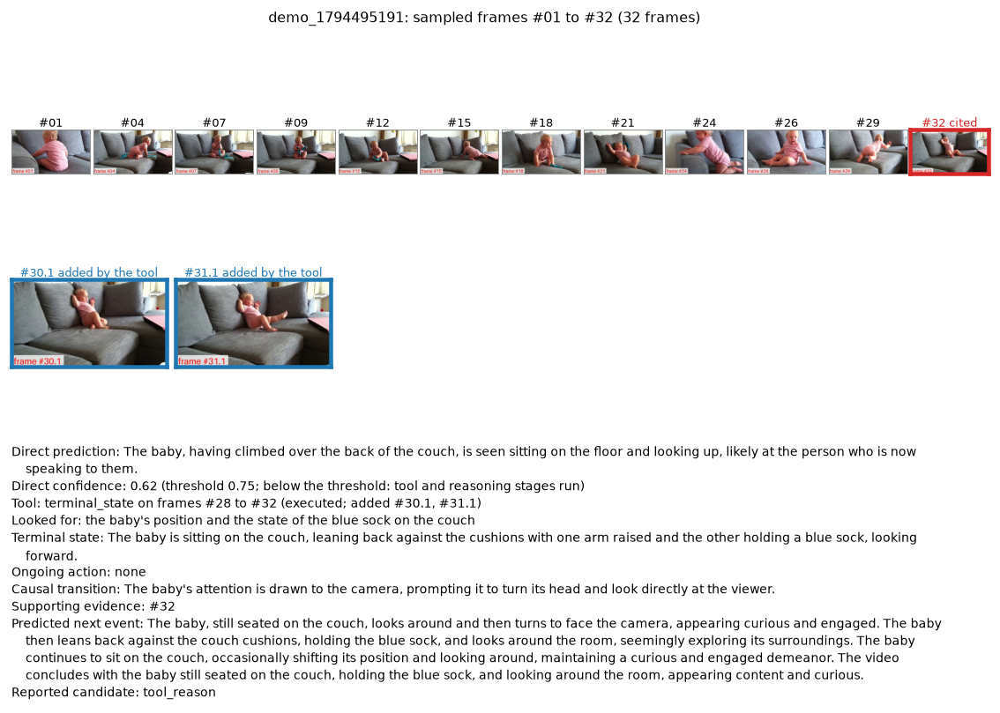

# demo/

영상을 올리면 NEPAgent가 실행되고, 단계별 출력과 최종 예측을 화면에서 확인하는 웹 데모입니다. `scripts/run_agent.py`와 같은 파이프라인, 같은 설정(`configs/nep_agent.yaml`)을 씁니다.

| 파일 | 내용 |
|---|---|
| `app.py` | 웹 데모(Gradio) |
| `video.mp4` | 대표 입력. 테스트 케이스 (a)와 같은 영상(소파 위의 아기, 관찰 구간 75초) |
| `output.json` | 아래 실행에서 Agent가 저장한 결과 JSON 원본 |
| `output.png` | 같은 실행에서 Agent가 그린 요약 그림 |

## 실행 방법

모델 준비(`README.md` 4절)를 마친 뒤 저장소 루트에서 실행합니다. 모델을 올리는 데 1~2분 걸립니다.

```bash
pip install gradio
PYTHONPATH=. python demo/app.py            # http://localhost:7860
PYTHONPATH=. python demo/app.py --share    # 외부에서 접속할 임시 주소 생성
```

| 입력 | 설명 |
|---|---|
| 입력 영상 | MP4 등 동영상 파일. 화면 아래 예시를 누르면 `demo/video.mp4`가 들어갑니다 |
| 관찰 구간 끝(초) | 이 시점 이후는 Agent에 전달되지 않습니다. 0이면 파일 전체 |
| 질문, 보기 | 선택. 비워 두면 영상만으로 예측합니다. 보기는 예측이 끝난 뒤 대응에만 씁니다 |
| 확신도 임계값 | 제출 설정은 0.75. 1.0으로 올리면 항상 도구와 인과 추론까지 실행합니다 |

화면에는 단계별 출력, 모델이 본 프레임(도구가 추가한 프레임 포함), 요약 그림, 결과 JSON 원본이 나옵니다. 결과 파일은 `results/demo/`에 저장됩니다.

## 대표 입력의 실행 결과

`demo/video.mp4`를 질문과 보기 없이 넣고 제출 설정으로 실행한 기록입니다(`output.json`, 모델 호출 3회, 11.9초).



| 단계 | 출력 |
|---|---|
| 1. 초기 예측 | "The baby, having climbed over the back of the couch, is seen sitting on the floor and looking up, ..." (아기가 소파 등받이를 넘어가 바닥에 앉아 있음) |
| 2. 확신도 게이트 | 확신도 0.616 < 0.75 → 도구와 인과 추론으로 진행 |
| 3. 도구 선택 | 마지막 상태 재확인, 구간 `#28`~`#32`, 확인할 대상 "아기의 위치와 파란 양말의 상태" |
| 4. 도구 실행 | 영상 끝 구간에서 프레임 2장 추가 (`#30.1`, `#31.1`) |
| 5. 인과 추론 | 마지막 상태 "아기가 소파에 앉아 쿠션에 기대고, 한 손에 파란 양말을 들고 앞을 봄" (근거 `#32`) → 인과 전이 "아기의 주의가 카메라로 향함" |
| 최종 예측 | "The baby, still seated on the couch, looks around and then turns to face the camera, ..." (아기가 소파에 앉은 채 주변을 둘러보고 카메라를 봄) |

- 초기 예측은 아기가 이미 바닥에 있다고 했으나, 끝 구간을 다시 본 뒤 "소파에 앉아 있음"으로 관찰이 바로잡혔고 예측도 그에 맞게 바뀌었습니다.
- 실제 다음 장면은 아기가 소파 팔걸이를 기어오르는 것입니다. 최종 예측은 아기의 위치는 맞혔으나 다음 행동은 맞히지 못했습니다.
- 같은 영상이라도 실행마다 문장이 조금씩 달라질 수 있습니다. 테스트 케이스 (a)(`results/qualitative/`)는 같은 영상의 다른 실행 기록입니다.

## 터미널에서 실행

```bash
PYTHONPATH=. python scripts/run_agent.py --video demo/video.mp4
```

결과는 `results/single/`에 JSON과 요약 그림으로 저장됩니다.
