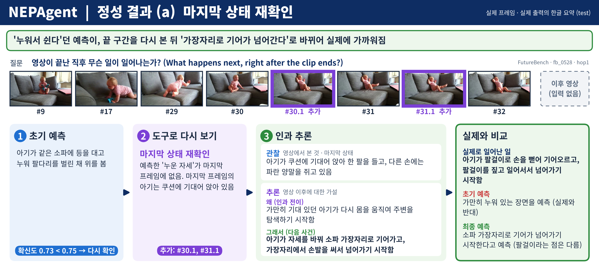

# demo/

대표 입력 하나로 NEPAgent의 실행 과정과 최종 결과를 단계별로 따라가는 자료입니다. 테스트 케이스 (a)(`results/qualitative/Q1_fb_0528_terminal_state/`)와 같은 영상이며, 아래 문장과 숫자는 모두 `nep_agent_output.json`에서 옮겼습니다.

| 파일 | 내용 |
|---|---|
| `video.mp4` | 입력 영상(관찰 구간 75초). 소파 위에서 아기가 움직이는 장면 |
| `question.json` | 질문과 보기. 보기는 예측 단계에 들어가지 않고 채점에만 씁니다 |
| `nep_agent_output.json` | 단계별 출력 요약 |
| `figure.png` | 실행 과정을 한 장으로 정리한 그림 |

## 실행 과정



| 단계 | 출력 |
|---|---|
| 1. 초기 예측 | "The video ends with the baby sitting on the couch, and the next scene shows the baby lying on its back on the same couch, looking up with its arms and legs spread out." (아기가 소파에 누워 팔다리를 벌림) |
| 2. 확신도 게이트 | 확신도 0.734 < 0.75 → 추가 단계로 진행 |
| 3. 도구 선택 | 마지막 상태 재확인, 확인할 대상 "소파 위 아기의 마지막 위치와 자세". 선택 이유: 예측한 누운 자세가 마지막 프레임에 없고, 아기는 쿠션에 기대어 앉아 있음 |
| 4. 도구 실행 | 영상 끝 구간에서 프레임 2장 추가 (`#30.1`, `#31.1`) |
| 5. 인과 추론 | 마지막 상태 "아기가 쿠션에 기대어 앉아 파란 양말을 쥐고 있음" → 인과 전이 "가만히 기대 있던 아기가 다시 몸을 움직여 주변을 탐색하기 시작함" → 예측 "아기가 소파 가장자리로 기어가, 손발을 써서 넘어가기 시작함" |

실제 다음 장면은 "아기가 팔걸이로 손을 뻗어 기어오르고, 팔걸이를 짚고 일어서서 넘어가기 시작함"입니다. 초기 예측(누워서 쉼)은 실제와 반대 방향이었고, 끝 구간을 다시 본 뒤의 예측은 실제에 가까워졌습니다. 다만 넘어가는 위치(가장자리와 팔걸이)는 다릅니다.

이 기록은 벤치마크 질문 대신 고정 질문("영상이 끝난 직후 무슨 일이 일어나는가?")으로 실행한 것입니다.

## 직접 실행하기

모델 준비(`README.md` 4절)를 마친 뒤 아래 명령으로 같은 영상에 Agent를 실행할 수 있습니다. 결과는 `results/single/`에 JSON과 요약 그림으로 저장됩니다.

```bash
PYTHONPATH=. python scripts/run_agent.py --video demo/video.mp4
```
