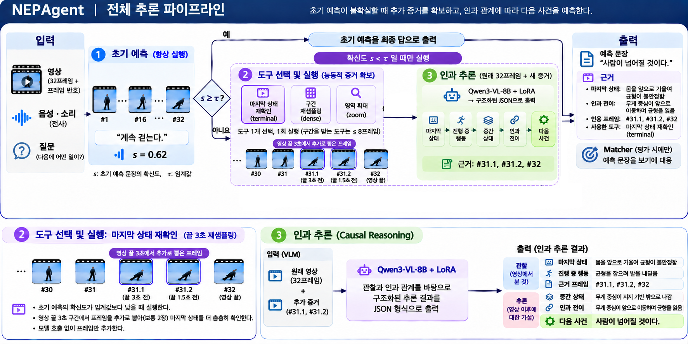
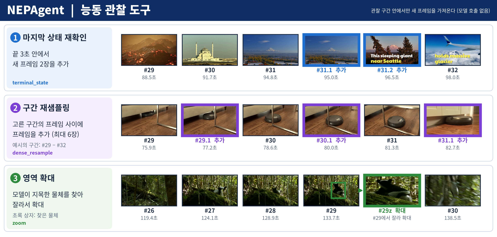
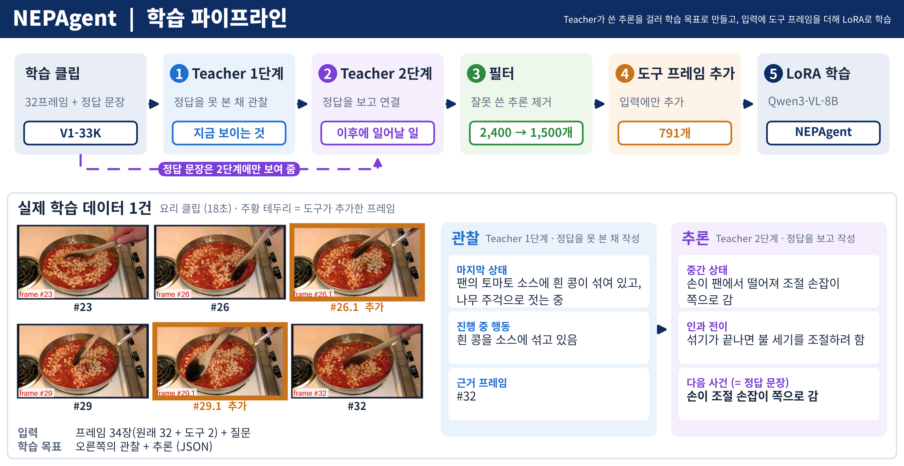
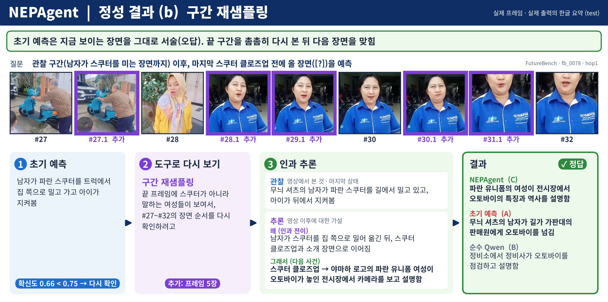
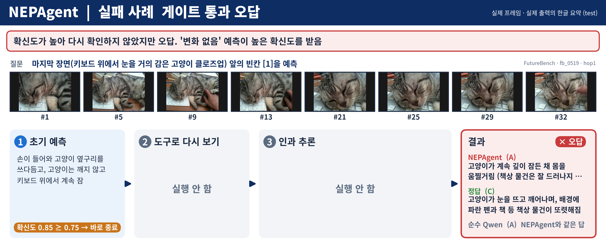

# NEPAgent: Executive Summary

**CJ 4DPLEX AI 개발 사전과제 · Track 1 Motion Prediction Agent**

## 1. 무엇을 만들었나

Track 1(Motion Prediction)을 **다음 사건 예측(Next-Event Prediction, NEP)**으로 구체화했습니다. NEPAgent는 영상의 앞부분(관찰 구간)만 보고, 바로 다음에 일어날 사건을 한 문장으로 예측하고 그 근거를 함께 제시합니다.

| 항목 | 내용 |
|---|---|
| 입력 | 영상의 관찰 구간 (이후 영상, 정답, 보기는 사용하지 않음) |
| 출력 | 다음 사건 예측 문장 + 근거(마지막 상태, 근거 프레임 번호, 인과 전이) |
| 대상 사용자 | 4DX 효과 제작자. 효과 후보 구간을 찾고 검토하는 것을 돕습니다 |
| 예측 단위를 사건으로 정한 이유 | 4DX 효과는 좌표가 아니라 사건(충돌, 물보라, 급정거 등) 단위로 붙습니다 |

## 2. 어떻게 동작하나

**그림 1.** 추론 파이프라인. 초기 예측의 확신도가 높으면(≥ 0.75) 바로 끝내고(test 문항의 54%), 낮으면 도구로 영상을 다시 본 뒤 인과 추론으로 예측을 다시 씁니다. 모든 단계가 Qwen3-VL-8B에 직접 학습한 LoRA를 붙인 단일 모델로 동작하며 외부 API는 쓰지 않습니다.

**그림 2.** 도구 3종. 마지막 상태 재확인(영상 끝 3초에서 프레임 2장 추가), 구간 재샘플링(고른 구간의 프레임 사이를 촘촘히 추가), 영역 확대(모델이 지목한 물체를 찾아 확대). 어떤 도구를 쓸지는 모델이 고릅니다.

## 3. 어떻게 학습했나

**그림 3.** 학습 파이프라인. V1-33K 학습 클립 1,500건에 2단계 Teacher를 적용했습니다. 1단계는 정답 없이 관찰만, 2단계는 정답을 보고 관찰과 정답을 잇는 추론만 씁니다. 추론 때의 입력과 맞추기 위해 절반가량의 입력에 도구가 추가하는 프레임을 넣었습니다. LoRA 학습은 A100 1장으로 약 6.9시간입니다.

## 4. 결과

학습 없는 Qwen3-VL-8B(순수 Qwen)와 비교했습니다. 보기 없이 문장을 예측한 뒤 보기에 대응시켜 채점했습니다.

| 범위 | 문항 | 순수 Qwen | NEPAgent | 차이 |
|---|---:|---:|---:|---:|
| test 전체 | 328 | 44.8 | **50.6** | **+5.8** |
| FutureBench | 200 | 50.0 | 57.5 | +7.5 |
| FutureOmni Speech | 128 | 36.7 | 39.8 | +3.1 |

test 328문항에서 정확도가 5.8pp 높습니다(FutureBench +7.5pp, FutureOmni Speech +3.1pp).

**그림 4.** 성공 사례(구간 재샘플링). 초기 예측은 지금 보이는 장면(스쿠터를 미는 남자)을 그대로 서술해 오답이었습니다. 끝 구간에 프레임 5장을 추가해 본 뒤 "유니폼 여성이 전시장에서 설명함"을 예측해 정답이 되었습니다.

**그림 5.** 실패 사례(확신도 게이트). "고양이는 깨지 않고 계속 잠"이라는 초기 예측의 확신도가 높아(0.847) 추가 단계 없이 끝났으나, 정답은 "고양이가 깨어남"이었습니다. 마지막 장면을 그대로 이어 쓴 예측은 확신도가 높게 나와 다시 검토되지 않습니다.

## 5. 한계와 다음 단계

| 한계 | 다음 단계 |
|---|---|
| 음악·효과음 같은 비언어 소리를 입력으로 쓰지 않음 | 오디오를 직접 입력받는 모델, 효과음 문항으로 평가 확대 |
| 도구 선택을 학습하지 않고, 도구를 1회만 실행 | 도구를 상황에 맞게 고르도록 학습 |
| 확신도 게이트가 오답을 잘 걸러 내지 못함 (그림 5) | 여러 번 예측해 일치하는 정도를 확신도로 사용 |
| 학습 데이터가 1,500건, 한 출처 | 데이터 규모와 출처 확대 |
| 사건이 언제 일어나는지는 예측하지 않음 | 사건 시점(TTE) 예측 추가 |

정확도가 50% 안팎이므로 현재는 자동 큐 생성이 아닌 **제작자 검토 보조** 용도가 적절합니다. 4DX 효과 제어와의 연동은 구현하지 않았습니다.

상세 내용은 `docs/Technical_Report.md`, 구조는 `docs/System_Architecture.md`, 사용 내역은 `docs/Usage_and_Implementation.md`에 있습니다.
