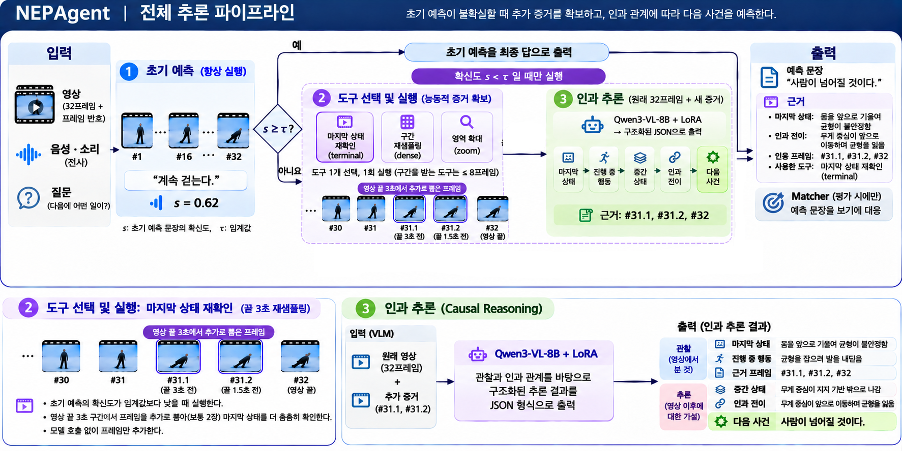
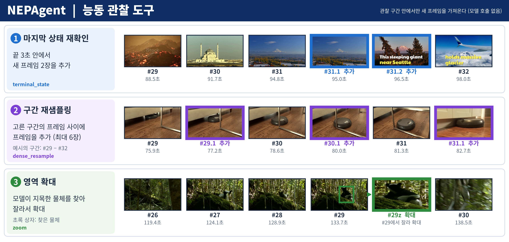
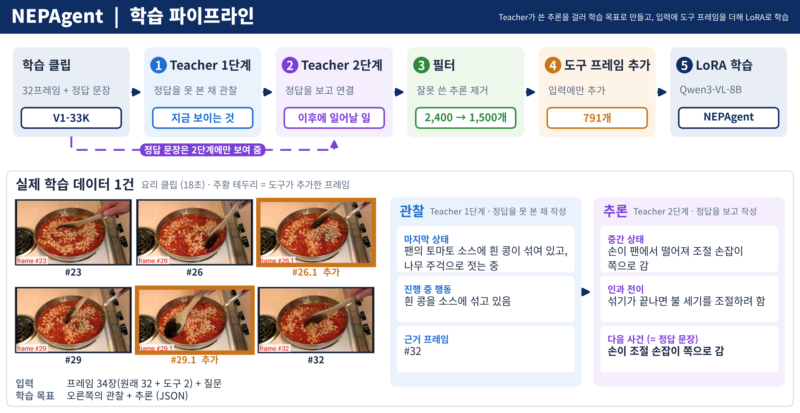

# NEPAgent: System Architecture

**CJ 4DPLEX AI 개발 사전과제 · Track 1 Motion Prediction Agent**

NEPAgent의 구조와 단계별 입출력을 정리한 문서입니다. 설계 근거와 평가 결과는 `docs/Technical_Report.md`, 실행 방법은 `README.md`에 있습니다.

## 1. 전체 구조



**그림 1.** 추론 파이프라인.

```
영상(관찰 구간)
  │  프레임 32장 균등 샘플링 + 프레임 번호 표시, Whisper 음성 전사
  ▼
① 초기 예측 ──▶ ② 확신도 게이트 ──(확신도 ≥ 0.75)──▶ 최종 예측
                      │
                (확신도 < 0.75)
                      ▼
               ③ 도구 선택 ──▶ ④ 도구 실행 ──▶ ⑤ 인과 추론 ──▶ 최종 예측
```

- 모든 모델 호출은 **Qwen3-VL-8B + NEPAgent LoRA** 하나로 처리합니다. 로컬 GPU에서 실행하며 외부 API는 쓰지 않습니다.
- 확신도가 높은 문항은 ①에서 끝나고, 낮은 문항만 ③~⑤를 거칩니다.

## 2. 단계별 입출력

| 단계 | 입력 | 출력 | 구현 |
|---|---|---|---|
| 관찰 | 영상의 관찰 구간 | 프레임 32장(왼쪽 아래에 `#01`~`#32` 표시), 음성 전사 텍스트 | `src/agent/observer.py`, `src/agent/vp.py`, `src/models/audio.py` |
| ① 초기 예측 | 프레임 32장, 음성 전사, 보기 없는 질문 | 다음 사건 한 문장, 확신도(생성 토큰 평균 로그확률의 지수값) | `src/stages/direct.py` |
| ② 확신도 게이트 | 확신도 | 종료 또는 추가 단계 진행 (임계값 0.75) | `src/stages/routing.py` |
| ③ 도구 선택 | 프레임 32장, 초기 예측 | 도구 1개, 프레임 구간(최대 8장), 확인할 대상(cue), 선택 이유 | `src/stages/tool_select.py` |
| ④ 도구 실행 | 도구, 구간, cue | 추가 프레임 또는 확대 이미지 (모델 호출 없음) | `src/agent/tools.py`, `src/agent/grounding.py` |
| ⑤ 인과 추론 | 원래 프레임 + 추가 프레임 | 마지막 상태, 근거 프레임, 인과 전이, 예측 사건 (JSON) | `src/nep_agent/event_reasoning.py` |
| Matcher (평가용) | 예측 문장, 질문, 보기 | 가장 가까운 보기 | `src/stages/matcher.py` |

- **보기는 Matcher에만 들어갑니다.** ①~⑤는 보기를 보지 않으며, 보기를 주지 않으면 Matcher를 건너뛰고 예측 문장과 근거만 냅니다.
- **실패 시 대체 순서**: ⑤가 답을 내지 못하면(JSON 형식 실패 등) 도구 없이 원래 프레임만으로 인과 추론을 한 번 더 하고, 그것도 실패하면 초기 예측을 최종 답으로 씁니다.
- 전체 흐름은 `src/nep_agent/core.py`, 설정은 `configs/nep_agent.yaml`입니다.

## 3. 도구



**그림 2.** 도구 3종의 실제 실행 예시.

| 도구 | 동작 | 추가되는 증거 |
|---|---|---|
| 마지막 상태 재확인 | 영상 끝 3초 구간에서 새 시점을 샘플링 | 프레임 2장 (예: `#31.1`, `#31.2`) |
| 구간 재샘플링 | 모델이 고른 구간의 프레임 사이를 촘촘히 샘플링 | 프레임 최대 6장 (예: `#29.1`, `#30.1`) |
| 영역 확대 | cue가 가리키는 물체를 Grounding DINO로 찾아 잘라 확대 | 확대 이미지 (예: `#29z`) |

- 추가 프레임은 앞 프레임의 하위 번호(`#31.1`)를 받아, 인과 추론이 근거 프레임으로 인용할 수 있습니다.
- 도구는 모두 관찰 구간 안에서만 동작합니다. 분할 시점 이후의 영상에는 접근하지 않습니다.

## 4. 출력 형식

결과는 문항마다 JSON 한 개로 저장됩니다. 인과 추론은 관찰한 것과 추론한 것을 구분합니다.

```json
{"observed": {"terminal_state": "...", "ongoing_action": "...", "supporting_evidence": ["#31.1", "#32"]},
 "inferred": {"intermediate_states": ["..."], "causal_transition": "...", "predicted_event": "..."}}
```

| 결과 JSON의 항목 | 내용 |
|---|---|
| `prediction.next_event` | 최종 예측 문장 |
| `prediction.answer` | Matcher가 대응시킨 보기 (보기를 준 경우) |
| `trace.direct` | 초기 예측 문장과 확신도, 게이트 결과 |
| `trace.nep_agent.reasoning` | 고른 도구·구간·cue, 도구 실행 결과, 인과 추론 JSON |
| `trace.nep_agent.final_source` | 최종 답의 출처(초기 예측 / 도구 뒤 추론 / 도구 없는 추론) |
| `frames` | 사용한 프레임 목록(번호, 시각, 출처) |

## 5. 학습 구조



**그림 3.** 학습 파이프라인(위)과 실제 학습 데이터 1건(아래).

| 단계 | 내용 | 구현 |
|---|---|---|
| ① Teacher 1단계 | 정답 없이 프레임만 보고 관찰을 작성 | `src/train/build_sft_reasoning.py` |
| ② Teacher 2단계 | 정답 문장을 보고, 관찰과 정답을 잇는 중간 상태·인과 전이만 작성 | 같은 파일 |
| ③ 필터 | 형식 오류, 정답 복사 등을 규칙으로 제거 → 1,500건 | 같은 파일 |
| ④ 도구 프레임 추가 | 791건의 입력에 추론 때와 같은 코드로 도구 프레임을 더함 | `src/train/build_sft_tool_inputs.py` |
| ⑤ LoRA 학습 | Qwen3-VL-8B에 LoRA(r 64) 3 epoch, A100 1장 약 6.9시간 | `src/train/configs/nep_agent_tool_evidence.yaml` |

Teacher는 학습 데이터를 만들 때만 쓰며, 추론 시스템에는 포함되지 않습니다.

## 6. 구성 요소

| 구성 요소 | 역할 | 비고 |
|---|---|---|
| Qwen3-VL-8B-Instruct + LoRA | 초기 예측, 도구 선택, 인과 추론, Matcher | LoRA는 직접 학습. vLLM으로 로컬 실행 |
| Whisper small | 음성 전사 | 사전 계산해 캐시 |
| Grounding DINO tiny | 영역 확대의 물체 탐지 | 탐지 실패 시 고정 영역으로 대체 |

| 코드 | 내용 |
|---|---|
| `src/agent/` | 프레임 샘플링과 번호 표시, 도구 실행, 결과 기록 |
| `src/stages/` | 초기 예측, 게이트, 도구 선택, Matcher와 각 프롬프트 |
| `src/nep_agent/` | 인과 추론과 전체 흐름 |
| `src/train/` | 학습 데이터 생성, 학습 설정, 어댑터 병합 |
| `scripts/` | 단일 영상 실행(`run_agent.py`), 벤치마크 실행(`run_benchmark.py`), 결과 표 생성 |
| `tests/` | 단위 테스트. 예측 단계에 미래 정보가 들어가지 않는지 검사(`test_no_leakage.py`) |

## 7. 실행 환경

- 추론: GPU 1장(A100 80GB 또는 RTX A6000 48GB)
- 학습: A100 80GB 1장
- Linux, Python 3.11
