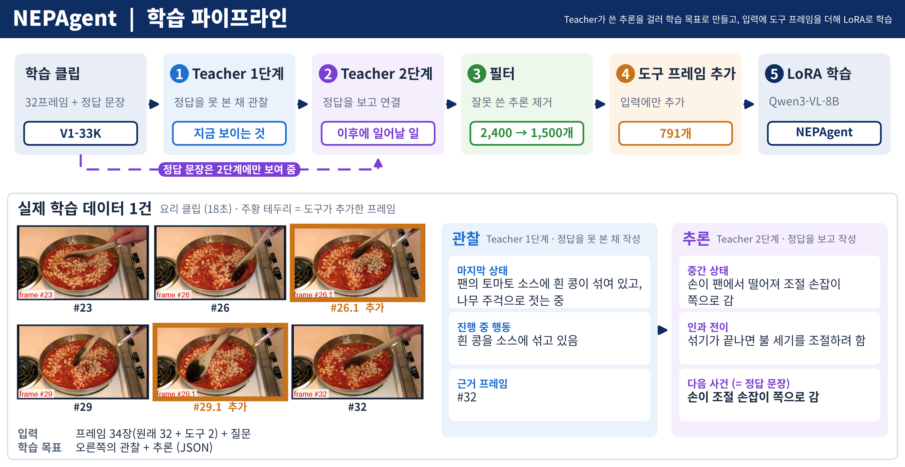
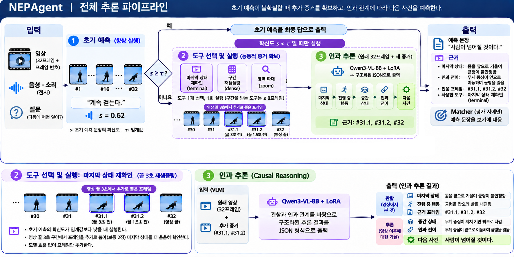
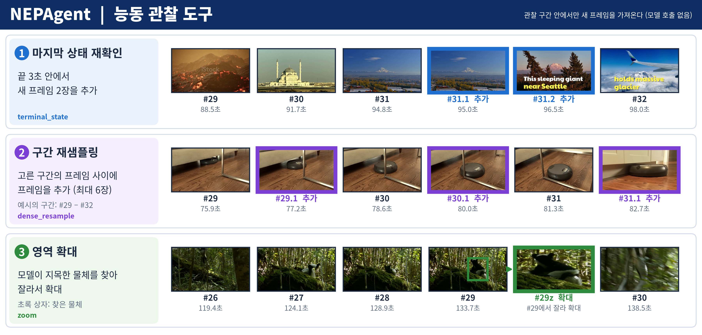
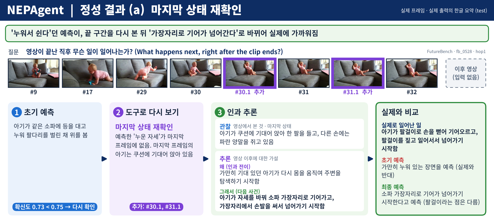
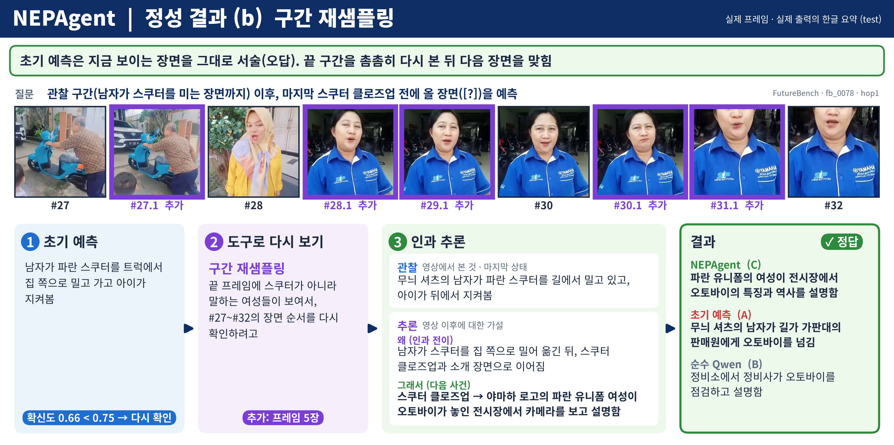
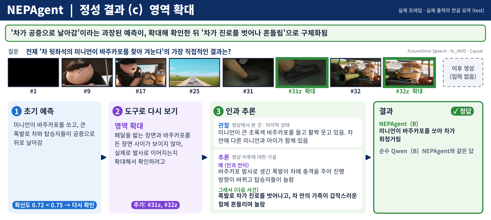
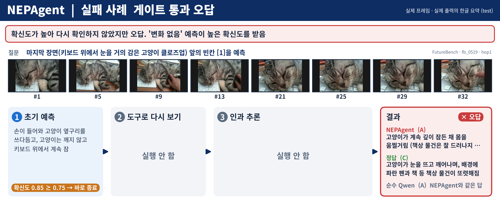
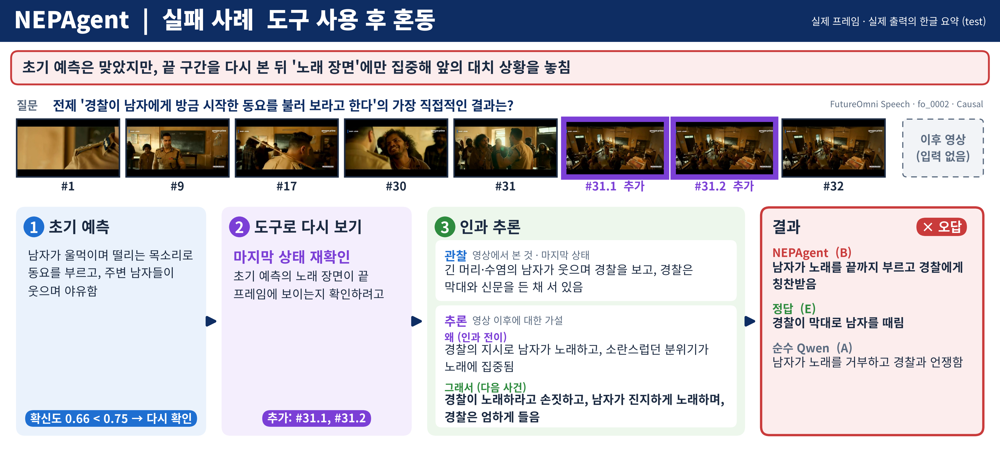

# NEPAgent: 관찰 영상 기반 다음 사건 예측 Agent

**CJ 4DPLEX AI 개발 사전과제 · Track 1 Motion Prediction Agent · Technical Report**

## 요약

| 구분 | 내용 |
|---|---|
| 목표 | Track 1(Motion Prediction)을 **다음 사건 예측(Next-Event Prediction, NEP)**으로 구체화. 영상의 관찰 구간만 보고, 직후에 일어날 사건을 한 문장으로 예측하고 근거를 함께 제시하는 Agent |
| 접근 | Qwen3-VL-8B [1] + LoRA 단일 모델. 초기 예측을 낸 뒤, 확신도가 낮은 문항만 도구로 영상을 다시 보고 인과 추론으로 예측을 다시 씁니다 |
| 결과 | test 328문항에서 학습 없는 Qwen3-VL-8B 대비 **44.8% → 50.6% (+5.8pp)** |
| 한계 | 비언어 소리(음악·효과음)를 입력으로 쓰지 않고, 도구 선택을 학습하지 않았습니다(7절) |

---

## 1. 문제 정의

### 1.1 배경

Track 1은 영상에서 시간에 따라 변하는 정보를 분석해 이후의 변화를 예측하는 과제입니다. 본 과제에서는 이를 **다음 사건 예측(Next-Event Prediction, NEP [3])**으로 구체화했습니다.

| 구분 | 내용 |
|---|---|
| 해결하는 문제 | 관찰 영상으로부터 후속 사건을 예측하는 Video AI Agent 개발 |
| 기술적 필요성 | 시간에 따른 상태 변화와 행동 간 인과관계를 추론하는 능력의 검증 |
| Agent가 필요한 이유 | 제한된 관찰 정보에서 필요한 증거를 선택적으로 다시 확인하고 추론하기 위함 |
| 4DX 연관성 | 향후 4DX 콘텐츠의 사건 및 장면 맥락 분석을 지원하는 기반 기술 |
| 실제 활용을 위한 추가 과제 | 사건 발생 시점, 효과 유형, 강도 및 타이밍 예측 |

- **NEP를 고른 이유(미래 예측의 필요성)**: 다음 사건을 맞히려면 사건의 순서, 마지막 상태, 진행 중인 행동, 그 사이의 인과 흐름을 함께 이해해야 합니다. 즉 영상 모델의 시간적·인과적 이해 능력을 직접 검증할 수 있는 문제입니다. 공개된 평가 벤치마크와 학습 데이터가 있어 기간 안에 학습과 정량 검증이 모두 가능합니다.
- **Agent 구조를 고른 이유(Agent의 필요성)**: 균등 샘플링한 프레임만으로는 마지막 순간이나 작은 대상처럼 예측에 필요한 시각적 증거가 부족할 때가 있습니다. Agent는 예측이 불확실할 때 필요한 구간을 스스로 골라 다시 확인하고, 그 증거로 추론을 다시 합니다.
- **4DX와의 관계**: 4DX 효과 큐잉을 직접 해결하는 것은 아닙니다. 사건과 장면의 맥락을 이해하는 기반 기술이며, 실제 활용에는 사건 발생 시점, 효과 유형, 강도와 타이밍 예측이 추가로 필요합니다(7.2절).

### 1.2 과제 정의

| 항목 | 정의 |
|---|---|
| 입력 | 영상의 관찰 구간(0초 ~ 분할 시점). 벤치마크에서는 주석이 지정한 시점까지 자른 클립 |
| 예측 대상 | 관찰 구간 직후의 다음 사건 1개 (자연어 한 문장) |
| 출력 | 예측 문장, 근거(마지막 상태, 근거 프레임 번호, 인과 전이), 사용한 도구와 구간 |
| 사용 금지 정보 | 분할 시점 이후 영상, 정답 문장, 보기. 보기는 예측이 끝난 뒤 채점에만 씁니다 |
| 활용 목적 | 영상의 사건·장면 맥락 분석을 지원하는 기반 기술. 4DX 효과 큐잉 자체는 범위에 넣지 않았습니다 |

### 1.3 성공 기준

| 기준 | 결과 |
|---|---|
| 같은 기반 모델(학습 없는 Qwen3-VL-8B)보다 test 정확도가 높음 | 달성 (+5.8pp, 5.1절) |
| 예측 단계에 미래 정보가 들어가지 않음 | 달성 (`tests/test_no_leakage.py`) |
| 추가 단계를 거친 예측은 근거를 함께 출력함 | 달성 (3.4절) |
| 추가 단계는 불확실한 문항에만 적용함 | 달성 (54% 문항은 초기 예측으로 종료) |

---

## 2. 데이터 구성

### 2.1 평가 데이터

| 벤치마크 | 형식 | 사용 범위 |
|---|---|---|
| FutureBench [3] | 4지선다. 관찰 이후 몇 단계 뒤 사건(hop 1/2/3/5) | test 200문항 |
| FutureOmni [2] | 5지선다. 영상·오디오 맥락의 다음 사건 | test 중 말소리(Speech) 128문항 |

- **test = 328문항**(FutureBench 200 + FutureOmni Speech 128)입니다. 분할은 영상 단위이며 학습 데이터와 겹치는 영상은 없습니다.
- NEPAgent는 오디오를 음성 전사로만 받으므로, FutureOmni는 입력 설계가 다루는 말소리 문항만 평가했습니다. 이 범위는 오디오 종류별 결과를 확인한 뒤 정했습니다.
- 두 벤치마크의 표준 평가는 보기를 함께 주는 객관식입니다. **NEPAgent는 보기 없이 문장을 생성하고, 보기는 채점에만 씁니다**(5절).

### 2.2 학습 데이터

V1-33K [3] 학습 클립에 Qwen3-VL-8B를 Teacher로 적용해 추론 학습 데이터 1,500건을 만들었습니다.



**그림 1.** 학습 파이프라인(위)과 실제 학습 데이터 1건(아래). 주황 테두리 `#26.1`, `#29.1`은 도구가 추가한 프레임입니다.

| 단계 | 내용 |
|---|---|
| ① Teacher 1단계 (정답 미제공) | 프레임만 보고 마지막 상태, 진행 중 행동, 근거 프레임을 작성 |
| ② Teacher 2단계 (정답 제공) | 1단계 관찰을 고정하고, 정답 문장까지 이어지는 중간 상태와 인과 전이만 작성 |
| ③ 필터 | JSON 오류, 인과 전이 누락, 관찰 구간을 되짚는 표현, 정답을 그대로 베낀 중간 상태를 규칙으로 제거 |
| ④ 도구 프레임 추가 | 1,500건 중 791건의 입력에 추론 때와 같은 코드로 도구 프레임을 더함(마지막 상태 재확인 640, 구간 재샘플링 151). 학습 목표는 그대로 둠 |

- **정답을 2단계에서만 보여 준 이유**: 처음부터 정답을 주면 관찰 서술에 정답이 섞일 수 있습니다.
- **1,500건의 구성**: 1차 표본 1,500개 중 필터 통과 997개 + 같은 풀에서 추가로 뽑은 후보 900개 중 통과분 503개. 필터 기준은 결과를 보기 전에 정했고, 통과분이 적어도 완화하지 않았습니다.
- **도구 프레임을 학습 입력에 넣은 이유**: 추론 때 불확실한 문항의 입력은 원래 32프레임에 도구 프레임이 더해진 형태입니다. 학습 입력을 이 형태와 맞췄습니다.
- **영상 출처**: YouTube 817, ActivityNet 329, YouCook2 195, NExT-QA 159. 평가 영상과 Charades·Ego4D 출처는 제외했습니다.

데이터의 출처와 라이선스는 `docs/Usage_and_Implementation.md`에 정리했습니다.

---

## 3. Agent 설계

### 3.1 전체 구조



**그림 2.** 추론 파이프라인.

| 단계 | 하는 일 | 실행 조건 |
|---|---|---|
| 1. 초기 예측 | 프레임 번호를 표시한 32프레임(ViKey [6] 방식)과 Whisper [7] 음성 전사를 보고 다음 사건을 한 문장으로 예측. 생성 확신도를 함께 기록 | 항상 |
| 2. 확신도 게이트 | 확신도 ≥ 0.75이면 초기 예측으로 종료 | 항상 |
| 3. 도구 선택 | 도구 1개, 구간, 확인할 대상(cue)을 모델이 고름 | 확신도 < 0.75 |
| 4. 도구 실행 | 프레임 추가 또는 영역 확대 (모델 호출 없음) | 확신도 < 0.75 |
| 5. 인과 추론 | 원래 프레임 + 추가 프레임을 보고 마지막 상태 → 인과 전이 → 다음 사건을 JSON으로 작성 | 확신도 < 0.75 |
| 6. Matcher | 예측 문장을 보기에 대응 (텍스트만 사용) | 보기가 있을 때(평가용) |

- 모든 단계가 같은 모델(Qwen3-VL-8B + NEPAgent LoRA)을 쓰며 temperature는 0입니다.
- 5단계가 답을 내지 못하면(JSON 형식 실패 등) 도구 없이 원래 프레임만으로 인과 추론을 한 번 더 하고, 그것도 실패하면 초기 예측을 씁니다.

### 3.2 설계 결정과 근거

| 결정 | 이유 |
|---|---|
| 초기 예측 우선 + 확신도 게이트 | 모든 문항에 추가 단계를 적용하면 처리 시간이 늘고, 맞힌 답을 틀리게 바꾸기도 합니다. test에서 게이트를 둔 구성(50.6)이 추가 단계를 모든 문항에 적용한 구성(50.0)보다 낮지 않았습니다 |
| 도구로 다시 보기 | 32프레임 균등 샘플링은 긴 영상에서 프레임 간격이 수 초 이상 벌어져 마지막 순간이나 짧은 동작을 놓칩니다 |
| 인과 추론을 JSON으로 학습 | 답만 학습하면 근거가 나오지 않습니다. 예측을 사람이 검증하려면 마지막 상태와 근거 프레임이 필요합니다 |
| 보기 없이 예측 | 실제 사용 환경에는 보기가 없습니다 |

Teacher로 추론 과정을 만들어 학습하는 방식은 Video-CoE [4], 관찰 구간을 다시 보는 도구와 인과 전이 추론은 VepAgent [5]를 참고했습니다. 가져온 것과 다르게 한 것은 `docs/Usage_and_Implementation.md` 4절에 정리했습니다.

### 3.3 도구



**그림 3.** 도구 3종의 실제 실행 예시.

| 도구 | 기능 |
|---|---|
| 마지막 상태 재확인 | 영상 끝 3초 구간에서 새 시점의 프레임 2장을 추가 (예: `#31.1`, `#31.2`) |
| 구간 재샘플링 | 모델이 고른 구간의 프레임 사이에 최대 6장을 추가 |
| 영역 확대 | 모델이 쓴 cue의 물체를 Grounding DINO [8]로 찾아 잘라 확대 |

- 도구 실행은 규칙 기반이고, 어떤 도구를 고를지는 프롬프트로만 정합니다(학습하지 않음).
- test에서 확신도가 낮았던 150문항에 모델이 고른 도구는 마지막 상태 재확인 113회, 구간 재샘플링 37회, 영역 확대 0회입니다.

### 3.4 출력 형식

인과 추론은 관찰한 것과 추론한 것을 구분해 출력합니다.

```json
{"observed": {"terminal_state": "...", "ongoing_action": "...", "supporting_evidence": ["#31.1", "#32"]},
 "inferred": {"intermediate_states": ["..."], "causal_transition": "...", "predicted_event": "..."}}
```

| 필드 | 의미 |
|---|---|
| `observed` | 관찰 구간에서 본 것: 마지막 상태, 진행 중 행동, 근거 프레임 번호 |
| `inferred` | 관찰 이후에 대한 가설: 중간 상태, 인과 전이, 예측 사건 |

---

## 4. 구현 방법

### 4.1 모델 학습

| 항목 | 값 |
|---|---|
| 기반 모델 | Qwen3-VL-8B-Instruct, vision tower 고정 |
| 방식 | LoRA (r 64, α 128), lr 1e-5, 3 epoch, 유효 배치 16 |
| 데이터 | 2.2절의 1,500건 |
| 자원 | 학습: A100 80GB 1장, 약 6.9시간. 추론: GPU 1장(A100 80GB 또는 RTX A6000 48GB) |
| 프레임워크 | LLaMA-Factory, PEFT |

### 4.2 코드 구성

| 영역 | 경로 |
|---|---|
| 프레임 샘플링·번호 표시, 도구 실행 | `src/agent/` |
| 초기 예측, 게이트, 도구 선택, Matcher와 프롬프트 | `src/stages/` |
| 인과 추론, 전체 흐름 | `src/nep_agent/` |
| 학습 데이터 생성, 학습 설정 | `src/train/` |
| 실행 설정 | `configs/nep_agent.yaml`(최종), `configs/plain_qwen.yaml`(비교 대상) |
| 실행·평가 스크립트 | `scripts/run_agent.py`, `scripts/run_benchmark.py`, `scripts/main_table.py` |
| 테스트 | `tests/` (미래 정보 누출 검사 포함) |

실행 방법은 `README.md`, 사용한 모델·데이터·오픈소스는 `docs/Usage_and_Implementation.md`에 있습니다.

---

## 5. 평가 및 검증 결과

**평가 방법**

| 항목 | 내용 |
|---|---|
| 비교 대상 | 순수 Qwen: 학습 없는 Qwen3-VL-8B, 32프레임, 프레임 번호·오디오 없음 |
| 지표 | 정확도. Matcher가 예측 문장에 대응시킨 보기가 정답 보기와 같은 비율 |
| 지표를 고른 이유 | 실제 사용 환경에는 보기가 없으므로 보기 없이 문장을 예측하게 하고, 사람이 만든 벤치마크 정답을 기준으로 맞았는지를 판정하기 위함입니다 |
| 정답 기준 | 벤치마크 주석의 정답 보기(실제 이후 영상에서 일어난 사건) |

순수 Qwen과 NEPAgent는 가중치(LoRA), 입력(프레임 번호, 음성 전사), 추가 단계가 모두 다릅니다. 따라서 아래 차이는 이 요소들의 합산 효과입니다.

### 5.1 주요 결과

**표 1. 순수 Qwen 대비 NEPAgent (test, 정확도 %)**

| 범위 | 문항 | 순수 Qwen | NEPAgent | 차이 |
|---|---:|---:|---:|---:|
| 전체 | 328 | 44.8 | **50.6** | +5.8 |
| FutureBench | 200 | 50.0 | 57.5 | +7.5 |
| FutureOmni Speech | 128 | 36.7 | 39.8 | +3.1 |

- 전체 328문항에서 5.8pp 높습니다.
- FutureBench에서 +7.5pp, FutureOmni Speech에서 +3.1pp입니다.

### 5.2 도구별 비교

확신도가 낮은 150문항에 도구를 하나만 쓰도록 강제해 다시 실행했습니다. 나머지 178문항은 초기 예측을 그대로 씁니다.

**표 2. 도구 구성별 정확도 (test, %)**

| 구성 | 전체 328 | FutureBench 200 | FutureOmni Speech 128 | 확신도 낮은 150문항 |
|---|---:|---:|---:|---:|
| 순수 Qwen | 44.8 | 50.0 | 36.7 | 41.3 |
| 마지막 상태 재확인만 | 50.0 | 56.5 | 39.8 | 48.0 |
| 구간 재샘플링만 | 50.0 | 57.0 | 39.1 | 48.0 |
| 영역 확대만 | 48.8 | 57.0 | 35.9 | 45.3 |
| **도구 3종 중 모델 선택 (NEPAgent)** | **50.6** | **57.5** | **39.8** | **49.3** |

- 모든 구성이 순수 Qwen보다 높습니다.
- 도구 간 차이는 작습니다(전체 기준 4문항 이내). 어느 도구가 어떤 유형에 유효하다고 구분할 근거는 없습니다.

### 5.3 테스트 케이스

초기 예측이 도구와 인과 추론을 거쳐 달라지는 과정을 도구별로 1건씩 보입니다. 세 사례 모두 초기 예측의 확신도가 0.75보다 낮아 추가 단계로 넘어간 문항입니다. 도구마다 그 도구가 필요한 조건의 영상을 골랐습니다: (a) 다음 행동이 마지막 순간의 자세에 달린 영상, (b) 끝 구간에서 장면이 빠르게 바뀌는 영상, (c) 작은 대상이 단서인 영상. 그림의 문장은 모델 출력을 한글로 요약한 것이고, 맨 위 한 줄은 사례의 요점입니다. 원문은 `results/qualitative/`의 사례 폴더에 있습니다.



**그림 4.** 사례 (a) 마지막 상태 재확인. 초기 예측 "누워서 쉰다" → 끝 구간을 다시 보고 아기가 앉아 있음을 확인 → "가장자리로 기어가 넘어간다". 실제 다음 장면(팔걸이를 기어오름)에 가까워졌으나 위치는 다릅니다. 벤치마크 질문 대신 고정 질문("영상이 끝난 직후 무슨 일이 일어나는가?")으로 실행한 기록입니다.



**그림 5.** 사례 (b) 구간 재샘플링. 초기 예측은 지금 보이는 장면(스쿠터를 미는 남자)을 그대로 서술해 오답 → 끝 구간에 5장을 추가해 본 뒤 "유니폼 여성이 전시장에서 설명함"을 예측해 정답. 구간 재샘플링만 쓰도록 한 실행의 기록입니다.



**그림 6.** 사례 (c) 영역 확대. 초기 예측 "차가 공중으로 날아감" → 마지막 두 프레임을 확대해 바주카포를 든 미니언을 확인 → "차가 진로를 벗어나 흔들림"(정답과 같은 내용). 영역 확대만 쓰도록 한 실행의 기록입니다.

- 사례는 이해하기 쉬운 것을 고른 동작 예시이며 정확도의 근거가 아닙니다.
- (b)만 초기 예측이 오답에서 정답으로 바뀐 문항입니다. (a)와 (c)는 초기 예측도 보기 채점으로는 정답에 대응했고, 예측 문장이 실제 사건에 가까워지는 과정을 보인 것입니다.
- (b)는 정답 장면의 인물이 관찰 영상 끝에 이미 등장합니다(7.1절 L7).

사례의 영상, 질문, 출력은 `results/qualitative/`에 있습니다.

---

## 6. 실패 분석

실패는 두 유형으로 나뉩니다.

| 유형 | 규모 (test) |
|---|---|
| A. 게이트를 통과한 오답 | 확신도가 높아 바로 끝난 178문항 중 86문항이 오답 |
| B. 도구 사용 후 혼동 | 확신도 낮은 150문항 중, 초기 예측은 맞았으나 도구를 쓴 뒤의 추론이 틀린 답으로 바뀐 경우 |

### 6.1 유형 A: 게이트를 통과한 오답



**그림 7.** 실패 사례 A. 확신도 0.847로 추가 단계 없이 끝났으나 오답입니다.

| 항목 | 내용 |
|---|---|
| 사례 | 키보드 위에서 잠든 고양이를 손이 쓰다듬는 영상. 초기 예측 "고양이는 깨지 않고 계속 잠". 정답은 "고양이가 눈을 뜨고 깨어남" |
| 원인 | 마지막 장면을 그대로 이어 쓴 "변화 없음" 예측은 생성 확률이 높아 확신도가 높게 나옵니다. 그래서 상태가 바뀌는 사건을 다시 검토할 기회가 없었습니다 |
| 한계 | 확신도로 초기 예측의 정답·오답을 가르는 성능(AUROC)이 0.55로 무작위(0.5)에 가깝습니다. 게이트는 추가 단계를 줄이는 데는 쓸모가 있지만 오답을 골라내는 신호로는 약합니다 |
| 개선 방향 | 예측을 여러 번 샘플링해 서로 일치하는 정도를 확신도로 사용(self-consistency). 또는 초기 예측의 정답 여부를 예측하는 분류기를 학습 |

### 6.2 유형 B: 도구 사용 후 혼동



**그림 8.** 실패 사례 B. 초기 예측은 정답이었으나 도구 사용 뒤 오답이 되었습니다.

| 항목 | 내용 |
|---|---|
| 사례 | 교실에서 막대를 든 경찰이 소란스러운 남자들과 대치하다가 한 남자에게 동요를 불러 보라고 하는 영상. 초기 예측은 정답("경찰이 막대로 남자를 때림")에 대응. 마지막 상태 재확인 뒤 "남자가 노래하고 경찰이 듣는다"로 바뀌어 오답 |
| 원인 | 끝 구간 프레임이 더해지자 추론이 끝 순간(노래를 시작하는 장면)에만 집중해, 앞에서 쌓인 대치 상황을 놓쳤습니다 |
| 한계 | 추가 프레임이 들어간 149문항 중 이를 근거로 인용한 추론은 8문항뿐입니다. 학습 목표가 원래 32프레임만 근거로 쓰고, 학습 입력의 도구도 모델의 실제 선택이 아니라 무작위로 배정했기 때문입니다 |
| 개선 방향 | (1) 추론이 추가 프레임을 근거로 인용할 때만 그 답을 채택. (2) 모델이 실제로 고른 도구로 학습 입력을 만들고, 추가 프레임을 근거로 쓰는 학습 목표를 확보. (3) 도구 선택 자체를 학습(VepAgent [5]) |

실패 사례의 영상, 질문, 출력은 `results/failure_cases/`에 있습니다.

---

## 7. 한계 및 개선 방향

### 7.1 한계와 개선 방향

| # | 한계 | 내용 | 개선 방향 |
|---|---|---|---|
| L1 | 소리 입력 범위 | 오디오는 Whisper 음성 전사로만 입력합니다. 음악·효과음은 입력에 들어가지 않으며, FutureOmni는 말소리 문항만 평가했습니다 | **효과음 처리**: 오디오를 직접 입력받는 모델을 쓰거나, 소리 사건 탐지 결과를 프레임 번호에 맞춰 입력. 음악·효과음 문항으로 평가 확대 |
| L2 | 학습 데이터 범위와 품질 | 학습 데이터 1,500건이 모두 FutureBench와 같은 출처(V1-33K)이고, FutureOmni 형식의 데이터는 없습니다. 8B Teacher가 쓴 마지막 상태가 정확한 비율은 감사 100건 중 51건입니다 | **데이터셋 확장**: 클립 수와 출처(영화·감시·교육 등)를 넓히고, 더 큰 Teacher와 사람 검수로 품질 확보 |
| L3 | 고정된 도구 사용 | 도구 1개를 1회만 실행하고, 도구 선택은 학습하지 않습니다. 학습 입력의 도구는 무작위로 배정했습니다. 확신도 게이트도 오답을 잘 걸러 내지 못합니다(6.1절) | **도구를 상황에 맞게 선택**: 모델이 실제로 고른 도구로 학습 입력을 만들고 도구 선택을 학습. 이후 강화학습(VepAgent [5])과 반복 호출로 확장 |
| L4 | 고정된 프레임 샘플링 | 처음 입력은 영상 길이·내용과 무관하게 32프레임 균등 샘플링입니다 | **프레임 선택도 상황에 맞게**: 장면 전환·움직임이 많은 구간은 촘촘히, 정적인 구간은 성기게 배분 |
| L5 | 단일 물체 확대 | 영역 확대는 cue 하나로 물체 하나만 찾아 자릅니다. 여러 물체·인물의 상호작용은 한 대상만 확대됩니다 | **다중 물체 확대**: cue를 여러 개 받아 물체별로 탐지·확대하고 물체 간 상대 위치를 함께 입력 |
| L6 | 긴 영상 | 관찰 구간이 최대 865초이며, 32프레임이면 간격이 약 27초까지 벌어집니다 | **영상 길이 대응**: 길이에 따라 프레임 수를 늘리거나, 구간별 요약 뒤 마지막 구간을 촘촘히 보는 계층형 입력 |
| L7 | 평가 방식 | Matcher가 질문과 보기를 보고, 평가 대상과 같은 모델로 실행됩니다. FutureBench는 질문에 이후 장면이 서술된 문항이 많고, 관찰 클립이 질문의 대상 장면과 겹치는 문항도 있습니다 | **더 엄격한 채점**: 질문을 보지 않는 Matcher 또는 의미 일치 직접 판정 |

### 7.2 4DX 활용 관점

- NEPAgent는 "관찰 영상 → 다음 사건 문장 + 근거"까지를 다룹니다. 4DX 콘텐츠의 사건과 장면 맥락을 분석하는 데 쓰일 수 있는 기반 기술이며, 효과 큐잉을 직접 해결하지는 않습니다.
- 실제 활용을 위해서는 사건 발생 시점, 효과 유형, 강도와 타이밍을 예측하는 단계가 추가로 필요합니다.
- 폭발·충돌음 같은 비언어 소리 입력(L1)도 함께 필요합니다.

---

## 부록. 재현 경로

| 내용 | 경로 |
|---|---|
| 최종 구성, 비교 대상 | `configs/nep_agent.yaml`, `configs/plain_qwen.yaml` |
| 벤치마크 실행 | `scripts/run_benchmark.py` (결과는 `results/quantitative/runs/`에 저장됨) |
| 도구 1종 실행 (표 2) | `configs/ablation/tools_only_*.yaml` |
| 표 생성 | `scripts/main_table.py`(표 1), `scripts/tool_ablation.py`(표 2) |
| 학습 설정 | `src/train/configs/nep_agent_tool_evidence.yaml` |
| 테스트 케이스, 실패 사례 | `results/qualitative/`, `results/failure_cases/` |

## 참고 문헌

- [1] S. Bai et al., "Qwen3-VL Technical Report", arXiv:2511.21631.
- [2] Q. Chen et al., "FutureOmni: Evaluating Future Forecasting from Omni-Modal Context for Multimodal LLMs", arXiv:2601.13836.
- [3] H. Wang et al., "Fostering Video Reasoning via Next-Event Prediction", arXiv:2505.22457.
- [4] Q. Su et al., "Video-CoE: Reinforcing Video Event Prediction via Chain of Events", arXiv:2603.14935.
- [5] Q. Chen et al., "VepAgent: Bridging Causal-Transition via Tool-Augmented Reinforcement Learning for Video Event Prediction", arXiv:2610.06293.
- [6] Y. Lee et al., "ViKey: Enhancing Temporal Understanding in Videos via Visual Prompting", arXiv:2603.23186.
- [7] A. Radford et al., "Robust Speech Recognition via Large-Scale Weak Supervision", arXiv:2212.04356.
- [8] S. Liu et al., "Grounding DINO: Marrying DINO with Grounded Pre-Training for Open-Set Object Detection", arXiv:2303.05499.
